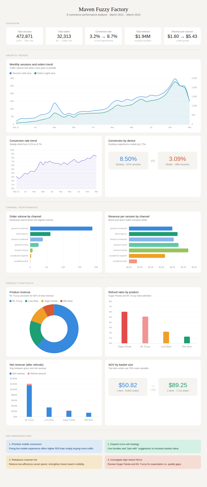
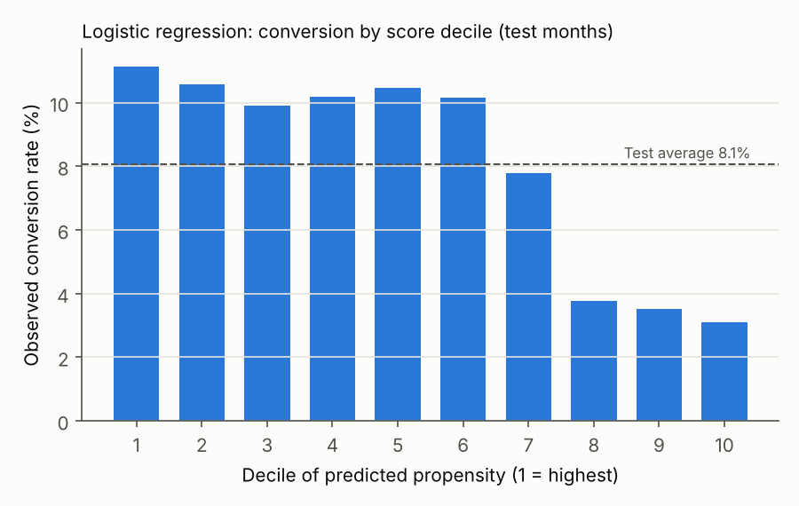
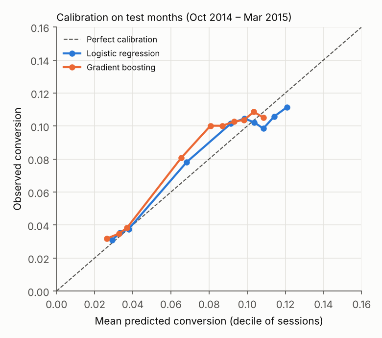
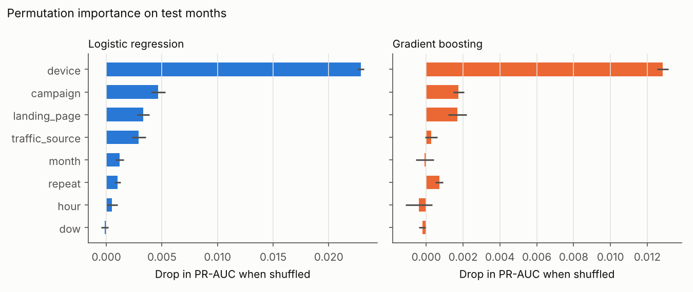
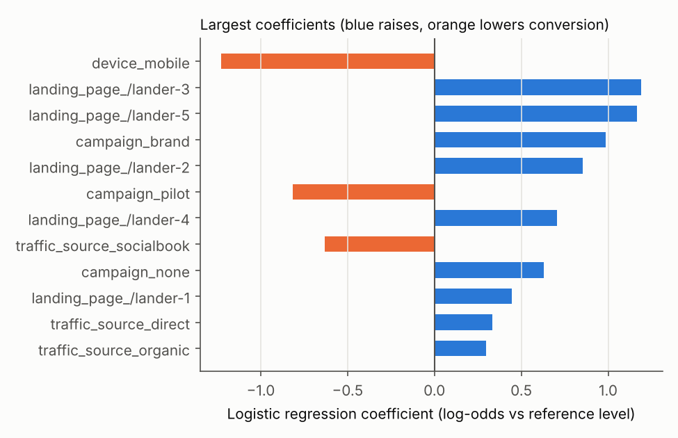
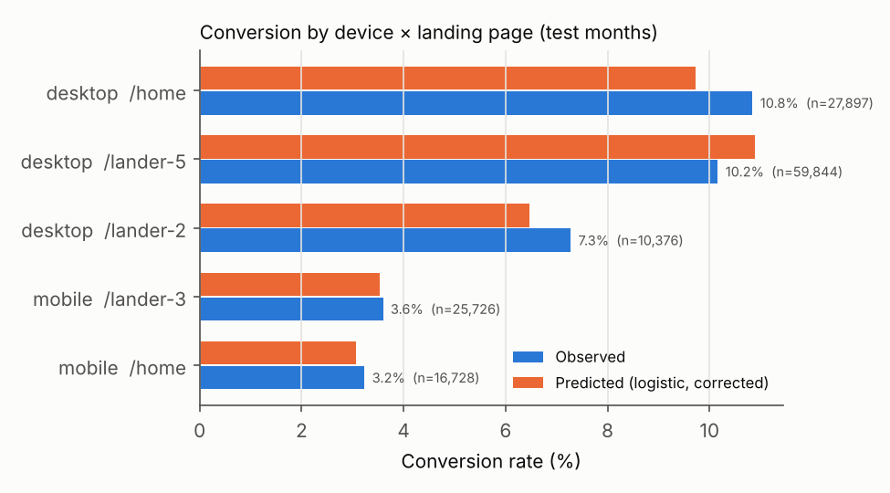
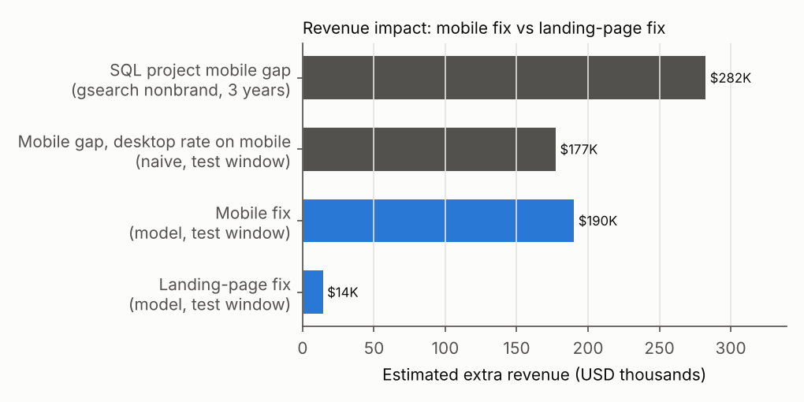

# Maven Fuzzy Factory: E-Commerce Funnel Analysis & Conversion Prediction

**SQL Server (T-SQL) · Python (pandas, scikit-learn) · matplotlib**

An end-to-end analysis of three years of data from Maven Fuzzy Factory, an online toy retailer. Five SQL phases take the data from raw CSVs to revenue, traffic, product and retention insights. A leakage-safe machine learning model then predicts, from what is known when a session starts, how likely that session is to end in an order, and uses that to compare two candidate product fixes.

**The headline:** mobile is the biggest lever in the business. If mobile sessions converted like comparable desktop sessions, the model estimates **+3,004 orders and +$190,211 in revenue over a 170-day holdout window**, about **13x** the value of the best landing-page change (+$14,256).



---

## Contents

1. [Dataset](#dataset)
2. [SQL analysis: five phases](#sql-analysis-five-phases)
3. [Conversion-propensity model](#conversion-propensity-model)
4. [Key business insights](#key-business-insights)
5. [Repository structure](#repository-structure)
6. [How to run](#how-to-run)
7. [Limitations](#limitations)

---

## Dataset

The Maven Fuzzy Factory dataset ([`Maven+Fuzzy+Factory.zip`](Maven%2BFuzzy%2BFactory.zip)) covers **19 March 2012 to 19 March 2015** across six relational tables, plus a data dictionary.

| Table | Rows | Role |
|---|---|---|
| `website_sessions` | 472,871 | Central fact table: device, UTM source/campaign, referer, repeat flag |
| `website_pageviews` | 1,188,124 | Page-level behaviour, used for the funnel |
| `orders` | 32,313 | Primary revenue source |
| `order_items` | 40,025 | Product-level transaction detail |
| `order_item_refunds` | 1,731 | Refunds and margin impact |
| `products` | 4 | Mr. Fuzzy, Forever Love Bear, Sugar Panda, Hudson River |

Overall conversion is **6.83%** (32,313 orders from 472,871 sessions).

---

## SQL analysis: five phases

All SQL scripts are in the repo root and run on Microsoft SQL Server against a database named `WEBANALYSIS`. The full report is in [`End-to-End SQL Business Analysis.pdf`](End-to-End%20SQL%20Business%20Analysis.pdf).

| Phase | Script | What it covers |
|---|---|---|
| 1. Import | [`P1 DATA IMPORT.sql`](P1%20DATA%20IMPORT.sql) | Table creation and `BULK INSERT` for all six CSVs |
| 1. Cleaning | [`P1 DATA CLEANING.sql`](P1%20DATA%20CLEANING.sql) | Duplicate checks, and converting text `'NULL'` values into real NULLs |
| 1. Exploration | [`P1-DATA EXPLORATION & QUALITY CHECK.sql`](P1-DATA%20EXPLORATION%20%26%20QUALITY%20CHECK.sql) | Row counts, date ranges and quality checks for every table |
| 2. Descriptive | [`PHASE-2- DESCRIPTIVE ANALYSIS.sql`](PHASE-2-%20DESCRIPTIVE%20ANALYSIS.sql) | Monthly revenue, AOV, YoY growth, Q4 seasonality |
| 3. Traffic & funnel | [`PHASE-3- TRAFFIC ANALYSIS.sql`](PHASE-3-%20TRAFFIC%20ANALYSIS.sql) | UTM sources, device performance, conversion funnel, mobile revenue gap |
| 4. Product profitability | [`Phase-4 - Product & Profitabilities.sql`](Phase-4%20-%20Product%20%26%20Profitabilities.sql) | Net margin after refunds, refund rates, hero-product concentration |
| 5. Cohort retention | [`PHASE 5 COHORT ANALYSIS.sql`](PHASE%205%20COHORT%20ANALYSIS.sql) | Monthly acquisition cohorts and repeat-purchase rates |

**Techniques used:** CTEs, window functions (`LAG`), `DATEDIFF`, `PIVOT`, conditional aggregation (`MAX(CASE WHEN ...)`), multi-table joins, `NULLIF` / `COALESCE`, funnel analysis, cohort analysis, and fixes for integer-division truncation in rate calculations.

### Validation and corrections

Every script was run end to end on **SQL Server 2022** against the six CSVs, in order, with **zero errors**. Imported row counts match the CSVs exactly, and the figures were cross-checked against an independent pandas calculation. Each change is marked in the code with a `-- [FIX]` or `-- [NOTE]` comment. Highlights:

* **String NULLs.** 83,328 sessions (17.6%) stored missing UTM values as the text `'NULL'`, so `IS NULL` checks found nothing. The cleaning script now converts them with `NULLIF`.
* **Line endings.** `website_sessions.csv` and `products.csv` use CRLF line endings, which left a hidden `CHAR(13)` in the last column of every row. These two tables now import with `ROWTERMINATOR = '0x0d0a'`.
* **AOV.** Yearly and monthly AOV were averages of monthly AOVs. They now use revenue ÷ orders (for example, 2014 AOV is $63.80).
* **Revenue-gap figures.** The mobile gap now uses the actual AOV of $59.99 instead of an assumed $64, giving **$264,537** (the report's $282,404 used $64). The Mr. Fuzzy funnel opportunity now uses the cart-to-order rate (34.03%) instead of the billing-to-order rate, giving **~$165,901** (the report said ~$322,000).

---

## Conversion-propensity model

Code: [`conversion_model.py`](conversion_model.py) and [`conversion_model.ipynb`](conversion_model.ipynb). Every reported number is in [`results_summary.md`](results_summary.md) and [`results.json`](results.json).

**Question:** using only what is known at the start of a session, how likely is it to convert, and which fix should be prioritised?

### Features and leakage control

* **Used:** device, traffic source (gsearch, bsearch, socialbook, organic, direct), campaign, landing page (first pageview only), new vs repeat, hour, day of week and month.
* **Excluded on purpose:** every pageview after the landing page (cart and billing are part of the outcome), session length, all order, item and refund fields, IDs, and a raw time trend.

### Method

* **Time-based split.** Train on 19 Mar 2012 to 30 Sep 2014 (332,300 sessions, 6.32% conversion). Test on 1 Oct 2014 to 19 Mar 2015 (140,571 sessions, 8.06% conversion, 170 days).
* **Models.** Class-weighted logistic regression (main, interpretable model), `HistGradientBoostingClassifier` for comparison, and a non-ML baseline: the training-period conversion rate of each device × source × landing-page segment.
* **Calibration.** The class re-weighting is undone with a prior correction computed from training data only.

### Results on the test months

| Model | ROC-AUC | PR-AUC | Top-decile conversion | Top-decile lift |
|---|---|---|---|---|
| **Logistic regression** | **0.609** | **0.104** | **11.13%** | **1.38x** |
| Gradient boosting | 0.607 | 0.103 | 10.50% | 1.30x |
| Segment-rate baseline | 0.602 | 0.101 | 9.99% | 1.24x |

A random ranking has PR-AUC 0.081. Start-of-session information carries a modest signal: the model ranks sessions better than chance but only slightly beats a segment lookup, which shows that almost all of what can be known at session start is captured by device, campaign and landing page.

After the prior correction the logistic model is well calibrated: a mean prediction of 0.0805 against 0.0806 observed, and a mean absolute gap of 0.0059 across 10 quantile bins.

<p>
  
  
</p>

### What drives conversion

Device is by far the strongest signal. Its permutation importance (drop in PR-AUC) is 0.0229, against 0.0046 for campaign, 0.0033 for landing page and 0.0029 for traffic source. Mobile has a logistic coefficient of −1.228 (odds ratio 0.29 vs desktop), brand campaign +0.987 (OR 2.68) and socialbook −0.632 (OR 0.53). These are associations, not causal effects.

<p>
  
  
</p>

### Mobile fix vs landing-page fix

In the test months, desktop converts at 7.3% to 10.8% depending on landing page, while mobile converts at 3.2% to 3.6% on both landing pages it used. Changing the mobile landing page alone therefore has little headroom.

| Scenario (170-day test window, AOV $63.32) | Sessions changed | Extra orders | Extra revenue |
|---|---|---|---|
| **Mobile fix:** mobile sessions convert like comparable desktop sessions | 42,454 | +3,004 | **+$190,211** |
| **Landing-page fix:** paid-lander sessions moved to the best lander for their device | 10,376 | +225 | +$14,256 |

The mobile fix is worth **13.3x** the landing-page fix, and gradient boosting gives a similar mobile estimate (+2,863 orders, +$181,267). Both figures are ceilings that assume the whole gap closes.

<p>
  
  
</p>

---

## Key business insights

1. **Prioritise mobile UX.** Within gsearch nonbrand, desktop converts at 8.22% and mobile at 3.18%. The SQL gap is $264,537 over three years for that campaign (at the actual $59.99 AOV), and the model puts closing the gap for all mobile traffic at up to $190,211 over 170 days. The two figures use different scopes and should not be added together.
2. **Fix the product-to-cart step for Mr. Fuzzy.** The product page → cart step loses 54.84% of sessions, the biggest leak in the funnel. Mr. Fuzzy, the highest-volume product (162,525 sessions), has the lowest cart rate at 43.04%. A 5-percentage-point improvement is worth about $165,901.
3. **Hero-product concentration risk.** Mr. Fuzzy is 62.5% of item revenue and 59.9% of net profit ($677,055 of $1,130,801). A single supply or quality issue would hit the business hard.
4. **Investigate Sugar Panda refunds.** A 6.04% refund rate pulls its margin from 68.5% down to about 62.5%. Hudson River has the highest net margin (67.1%) and the lowest refund rate (1.28%), making it the benchmark.
5. **Retention is almost non-existent but improving.** 98% of customers never return after their first order, and only 617 of 32,313 orders (1.94%) are repeats. Month-1 repurchase has risen from 0.3% for the 2012-09 cohort to 1.8% for the 2014-04 cohort, so a post-purchase programme has room to work.
6. **Growth is real.** Monthly revenue grew from about $3,000 (Mar 2012) to $144,800 (Dec 2014). December YoY growth accelerated from +130.3% to +148.6%, and Q4's share of annual revenue fell from 57.8% (2012, a partial year) to 36.4% (2013) and 35.0% (2014).
7. **Organic traffic converts best.** Untagged traffic converts at 7.34%, and organic search alone at 7.51%, at no acquisition cost.

---

## Repository structure

All files sit in the repo root.

```
.
├── README.md
├── maven_fuzzy_factory_infographic_en.png       # one-page visual summary
├── End-to-End SQL Business Analysis.pdf         # full written report
├── End-to-End SQL Business Analysis.docx        # editable version of the report
├── Maven+Fuzzy+Factory.zip                      # raw data: 6 CSVs + data dictionary
│
│   SQL (run in this order)
├── P1 DATA IMPORT.sql
├── P1 DATA CLEANING.sql
├── P1-DATA EXPLORATION & QUALITY CHECK.sql
├── PHASE-2- DESCRIPTIVE ANALYSIS.sql
├── PHASE-3- TRAFFIC ANALYSIS.sql
├── Phase-4 - Product & Profitabilities.sql
├── PHASE 5 COHORT ANALYSIS.sql
│
│   Conversion model
├── conversion_model.py                          # end-to-end pipeline
├── conversion_model.ipynb                       # same pipeline as an executed notebook
├── requirements.txt
├── results_summary.md                           # every reported number
├── results.json                                 # machine-readable results
│
│   Charts (generated by the model)
├── calibration.png
├── device_landing_conversion.png
├── lift_by_decile.png
├── permutation_importance.png
├── revenue_impact.png
└── top_coefficients.png
```

---

## How to run

### 1. Get the data

```bash
unzip Maven+Fuzzy+Factory.zip -d data/
```

### 2. SQL (Microsoft SQL Server)

1. Create a database named `WEBANALYSIS`.
2. In `P1 DATA IMPORT.sql`, change the `BULK INSERT ... FROM` paths to point at your `data/` folder.
3. Run the scripts in this order: `P1 DATA IMPORT.sql` → `P1 DATA CLEANING.sql` → `P1-DATA EXPLORATION & QUALITY CHECK.sql` → Phase 2 → Phase 3 → Phase 4 → Phase 5.

The import uses `CODEPAGE = '65001'`, which works on Windows. On SQL Server for Linux, remove that option.

### 3. Conversion model (Python)

```bash
pip install -r requirements.txt
python conversion_model.py --data-dir data --out-dir outputs
```

Or open `conversion_model.ipynb` and set the `DATA_DIR` and `OUT_DIR` environment variables (defaults: `data/` and `outputs/`). A full run takes about 35 seconds on a 4-core machine.

The script does not overwrite the files in the repo root. It writes `results.json` and `results_summary.md` to `outputs/` and the six charts to `outputs/charts/`, creating those folders if needed. The copies in the root are from the final run.

---

## Limitations

* The data is observational, so coefficients and counterfactuals are associations. Device is entangled with landing page and campaign, and an A/B test is the way to size a real mobile fix.
* The counterfactual revenue figures are ceilings that assume the whole gap closes, assume AOV stays the same, and are gross revenue, not margin.
* Conversion rose over time, and month-of-year is the only calendar feature, so the model cannot anticipate site-wide improvements.
* 2012 and 2015 are partial years, which inflates the 2012 Q4 share.
